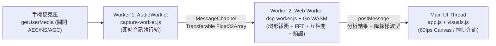

# Speaker Tuning — 網頁版音響皇帝位與 Toe-in 調校工具規格書 (SPEC)

## 1. 專案目標

打造一個可部署於 Cloudflare 的純前端靜態網頁工具，讓使用者僅需透過**手機瀏覽器麥克風**與**標準雙聲道測試音（WAV）**，即可完成：

1. **標準測試音生成與 WAV 下載**：產生無損 48kHz / 16-bit Stereo WAV 測試檔（並支援網頁直接播放），適用所有音響播放裝置。
2. **皇帝位（Sweet Spot）精準定位**：利用左右聲道到達時間差（TDOA）與音量平衡（SPL Balance），提供公分等級的左右偏移指示。
3. **左右喇叭 Toe-in / Toe-out 角度建議**：透過高頻指向性（4k–12kHz）相對於中頻（400–2kHz）的能量比，以及直達聲/早期反射清晰度，診斷左右角度對稱性與微調方向。
4. **即時視覺化波型與擺位示意圖**：呈現即時收音波型、L/R 互相關脈衝波型、頻帶能量對比，以及皇帝位與喇叭指向俯視圖。

---

## 2. 系統架構（收音與運算雙執行緒分離）

因本機環境無 Rust 工具鏈，本專案採用 **Go (1.26+) 編譯為 WebAssembly (`GOOS=js GOARCH=wasm`)** 作為前端 DSP 核心，並將「即時收音」與「重度訊號運算」完全分離於不同的 Worker 執行緒：



### 執行緒職責分工
- **AudioWorklet (`web/workers/capture-worklet.js`)**：專責從麥克風收取 128-sample 音訊區塊，累積為 2048 samples 後透過 `MessageChannel` 直接轉移（Zero-copy Transferable）給 DSP Worker，不經過主執行緒、不做重運算。
- **DSP Web Worker (`web/workers/dsp-worker.js` + `dsp.wasm`)**：載入 Go WASM 核心，維護約 2.8 秒的環形緩衝區，定期執行 Radix-2 FFT 互相關分析與頻帶能量計算，並負責離線產生標準測試 WAV 檔。
- **Main UI Thread (`web/js/app.js`, `web/js/visuals.js`)**：負責麥克風權限管理、測試音播放/下載、Canvas 波型與擺位圖繪製、基準鎖定（Baseline）與文字建議呈現。

---

## 3. 聲學訊號與 DSP 演算法規格

### 3.1 標準測試訊號格式
- **取樣率**：`48,000 Hz`（WAV 檔輸出）；DSP 分析端會依瀏覽器 `AudioContext.sampleRate`（如 44.1kHz 或 48kHz）動態生成對應模板。
- **週期（Frame Period）**：`1.60 秒` 循環（下載的 WAV 檔預設包含 15 個週期，總長 24 秒，方便各類播放器循環播放）。
- **單週期結構**：
  - `0.00s – 0.12s`：**左聲道（L）對數上掃 Chirp（Up-Chirp）**，`300 Hz → 14,000 Hz`，前後各 10% Hann 淡入淡出（Tukey 窗）。
  - `0.12s – 0.80s`：靜音（0.68 秒供房間殘響衰減）。
  - `0.80s – 0.92s`：**右聲道（R）對數下掃 Chirp（Down-Chirp）**，`14,000 Hz → 300 Hz`，與 L 具完全相同的功率頻譜與窗函數。
  - `0.92s – 1.60s`：靜音（0.68 秒殘響衰減）。
- **設計優勢**：
  - L（上掃）與 R（下掃）波形正交，互相關不會互相誤觸，手機無論從哪一秒開始收音皆能自動辨識左右聲道。
  - 兩者頻譜能量完全對稱，可公平比較左右聲道 SPL 與高頻 Toe-in 能量。

### 3.2 皇帝位時間差（TDOA）計算
1. 使用長度 `N = 131,072`（約 2.73 秒 @ 48kHz）之 Radix-2 FFT，將收音訊號分別與 L、R 模板做頻域互相關（Matched Filter）。
2. 在互相關包絡線上尋找主波峰 `idxL`、`idxR`，並對波峰前後各 1 點做**拋物線內插（Parabolic Interpolation）**取得次樣本（Sub-sample）精度。
3. 計算相對時間差：
   $$\Delta t = \text{wrap}\left((t_R - t_L) - \frac{T_{\text{period}}}{2},\ T_{\text{period}}\right)$$
4. 換算等效距離偏移（聲速 $c = 343\text{ m/s}$，標準 60° 正三角形擺位下橫向偏移 $\Delta x \approx \Delta d$）：
   - $\Delta t > 0$（右聲道較晚到達）：使用者偏左 → 提示「**往右移動**」。
   - $\Delta t < 0$（右聲道較早到達）：使用者偏右 → 提示「**往左移動**」。
   - $|\Delta d| \le 1.5\text{ cm}$：判定為「**已進入皇帝位中軸**」。

### 3.3 Toe-in / Toe-out 角度診斷演算法（準無響時間閘門）
1. 直接從互相關壓縮後的脈衝響應峰值 `corrL[idxL]`、`corrR[idxR]` 擷取 **`[-3 ms, +9 ms]` 時間閘門（Time-Gated Impulse Response）** 並加 Tukey 窗執行 2048 點 FFT，以過濾房間中晚期反射波，並完全消除上掃/下掃 Chirp 邊界裁切差異。
2. 對對數掃頻自相關頻譜進行 $f^2$ 白化校正後，計算兩大頻帶能量（dB）：
   - **中頻參考帶（MF）**：`400 Hz – 2,000 Hz`（指向性弱，受角度影響小）
   - **高頻指向帶（HF）**：`4,000 Hz – 12,000 Hz`（高音單體指向性強，對 Toe-in 極為敏感）
3. 計算高頻亮度比 `hfRatio = HF_dB - MF_dB` 並套用指數移動平均（EMA, $\alpha = 0.35$）穩定讀值：
   - **左右對稱差** `asymmetry = hfRatioL - hfRatioR`：手機麥克風自身頻響在相減時完全抵銷。
   - 若 `asymmetry < -1.2 dB`：建議增加左喇叭 Toe-in（往內轉）或減少右喇叭 Toe-in。
   - 若 `asymmetry > +1.2 dB`：建議增加右喇叭 Toe-in（往內轉）或減少左喇叭 Toe-in。
4. **直達聲清晰度（Direct-to-Early Ratio）**：比較脈衝響應主峰（±2.5ms）與早期反射區（+3ms ~ +30ms）能量比，輔助判斷側牆反射是否過強。
5. **基準鎖定（Baseline）**：允許使用者固定手機後鎖定當前 HF/MF 基準，轉動喇叭時即時顯示 `ΔdB` 變化以尋找 0° On-axis 峰值或對稱微 Toe-out。

---

## 4. 目錄架構

```text
speaker-tuning/
├── SPEC.md                     # 本規格書
├── README.md                   # 專案說明、建置與部署指南
├── AGENTS.md                   # 專案專屬 Agent 開發規範
├── package.json                # 建置、開發與部署腳本
├── wrangler.jsonc              # Cloudflare Workers Static Assets 部署設定
├── scripts/
│   └── build.mjs               # 建置腳本：編譯 Go WASM & CLI、組裝 dist/ 與 bin/
├── dsp/                        # Go DSP 核心模組
│   ├── go.mod
│   ├── signal/
│   │   ├── chirp.go            # Up/Down Log-Chirp 與 Stereo WAV 產生器
│   │   ├── fft.go              # 純 Go Radix-2 FFT / IFFT 與互相關工具
│   │   ├── analyzer.go         # 皇帝位 TDOA、SPL、Toe-in 頻帶與清晰度分析器
│   │   └── analyzer_test.go    # 聲學模擬單元測試
│   └── cmd/
│       ├── wasm/
│       │   └── main.go         # Go WASM 入口（註冊 JS 全域橋接函式）
│       └── genwav/
│           └── main.go         # 獨立 CLI 測試音產生器
├── web/                        # 前端靜態原始碼（原生 ES Modules + Modern CSS）
│   ├── index.html
│   ├── styles/
│   │   └── main.css
│   ├── js/
│   │   ├── app.js              # 主應用程式與雙 Worker 通訊管線
│   │   └── visuals.js          # Canvas 即時波型、脈衝波型、頻帶對比與擺位雷達圖
│   └── workers/
│       ├── capture-worklet.js  # AudioWorklet 收音處理器
│       └── dsp-worker.js       # Web Worker (載入 Go WASM)
├── bin/                        # 封裝產出（dsp.wasm、gen-test-wav.exe、預設測試 WAV）
└── dist/                       # Cloudflare 部署用靜態檔案目錄
```

---

## 5. Phase 2：低頻駐波測試（Room Modes, 30–320 Hz）

針對書架與落地喇叭（例如 MBL 311 C4，標稱 38 Hz – 45 kHz）在一般居家空間容易激發的房間低頻駐波，提供專屬量測分頁：

### 5.1 專用低頻掃頻訊號（`speaker-tuning-bass-48k.wav`）
- **週期**：`5.00 秒` 循環（WAV 預設 6 週期共 30 秒，L+R 同相單聲道輸出以同時激發雙喇叭房間駐波）。
- **單週期結構**：
  - `0.00s – 0.10s`：同步前導音（Sync Marker，800 Hz → 2,400 Hz Up-Chirp），供 DSP Worker 自動鎖定掃頻起點，無需手動對時。
  - `0.10s – 0.35s`：靜音間隔（0.25 秒）。
  - `0.35s – 4.35s`：低頻對數掃頻（`30 Hz → 320 Hz`，長度 4.00 秒，5% Hann 淡入淡出），充分激發穩態房間駐波。
  - `4.35s – 5.00s`：殘響衰減靜音（0.65 秒）。

### 5.2 抗手機麥克風低頻滾降演算法
手機內建 MEMS 麥克風在 `40–100 Hz` 常有平緩的硬體高通滾降，本工具透過兩層機制處理：
1. **喇叭低頻下限（`f_min`）過濾**：預設 `40 Hz`（適合 MBL 311 C4），開放 `35 / 40 / 50 / 60 / 80 Hz` 選擇，僅於 `[f_min, 250 Hz]` 評分駐波與標記峰谷，避免將低於喇叭下限的衰減誤判為駐波凹陷。
2. **去趨勢模式（Detrended Mode Deviation）**：對 `30–320 Hz` 100 點對數頻率曲線計算約 1 個八度寬的平滑趨勢線並相減，抵銷手機麥克風平緩斜率，凸顯窄帶劇烈起伏之駐波峰（Peak ≥ +4.0 dB）與凹陷（Null ≤ -4.5 dB）；同時提供原始曲線切換。
3. **多位置 A/B 快照疊圖**：同一支手機於不同擺位（例如喇叭離後牆 40cm vs 60cm）擷取快照疊圖比較平坦度（StdDev dB），手機麥克風特性於相對比較時完全抵銷。

---

## 6. 手機優先介面設計（Mobile-First UI）

考量使用者會拿著手機坐在聆聽位單手操作，介面以手機直式排版為主（`max-inline-size: 520px` 置中、支援 `viewport-fit=cover` 與 `env(safe-area-inset-*)` 安全區域）：
- **分段式分頁（Segmented Tabs）**：分為「皇帝位」、「Toe-in」、「低頻駐波」、「測試音」四頁，減少滑動干擾。
- **雙調校模式切換（「移動座位找皇帝位」vs「固定座位調喇叭」）**：支援鎖定使用者實際固定座位（例如偏左沙發位），整合呈現**距離對齊（前後拉動公分數 / 延遲 ms）＋ Toe-in 角度建議 ＋ 音量/Balance 補償**三合一即時指令。
- **置頂 Hero 判讀區**：以大字體直接顯示移動方向與公分數（如 `← 往左 3.2 cm` / `✓ 0.4 cm`）。
- **底部固定單手操作列（Sticky Bottom Bar）**：固定 `開始單次量測 (自動停)`（≥ 48px 觸控高度）、`單次 / 連續` 模式切換鈕與 `⬇ WAV` 快捷鍵於大拇指可及區域。預設「單次量測」會自動收集 4 輪皇帝位訊號（約 6 秒）或 2 輪低頻掃頻（約 10 秒），取平均後自動停止收音並定格鎖定結果，方便逐次對比。

---

## 7. 部署規格（Cloudflare）

- 透過 **Cloudflare Workers Static Assets**（`wrangler.jsonc` 之 `assets.directory = "./dist"`）部署，自動提供 HTTPS（滿足手機 `getUserMedia` 安全環境要求）與全球 CDN 加速。
- 靜態資源包含 `.wasm` 檔案，Cloudflare 預設正確回傳 `application/wasm` MIME type。
